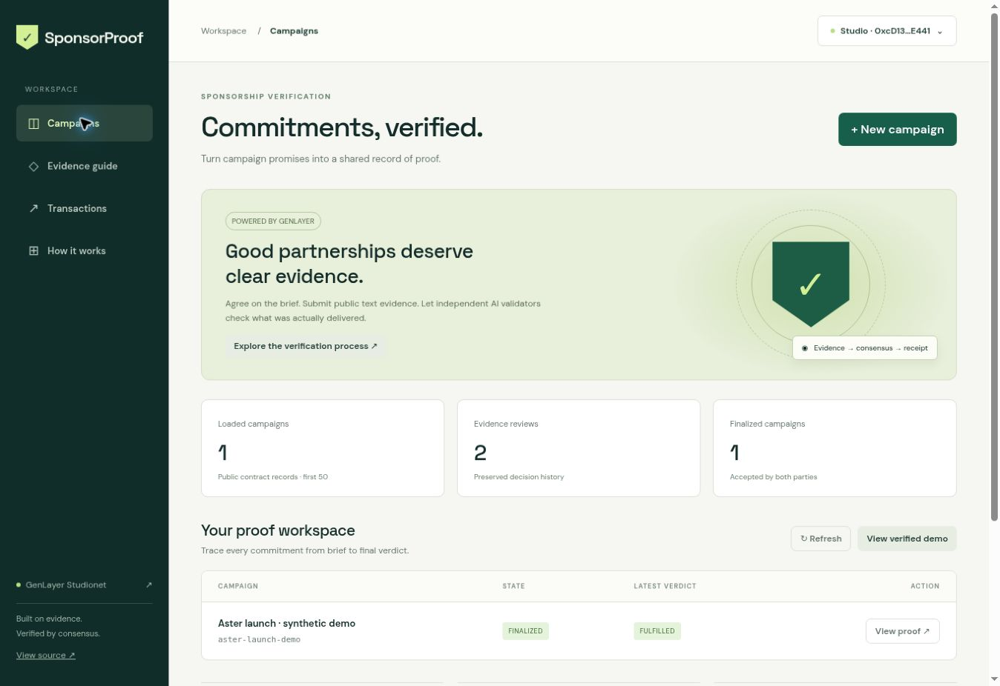
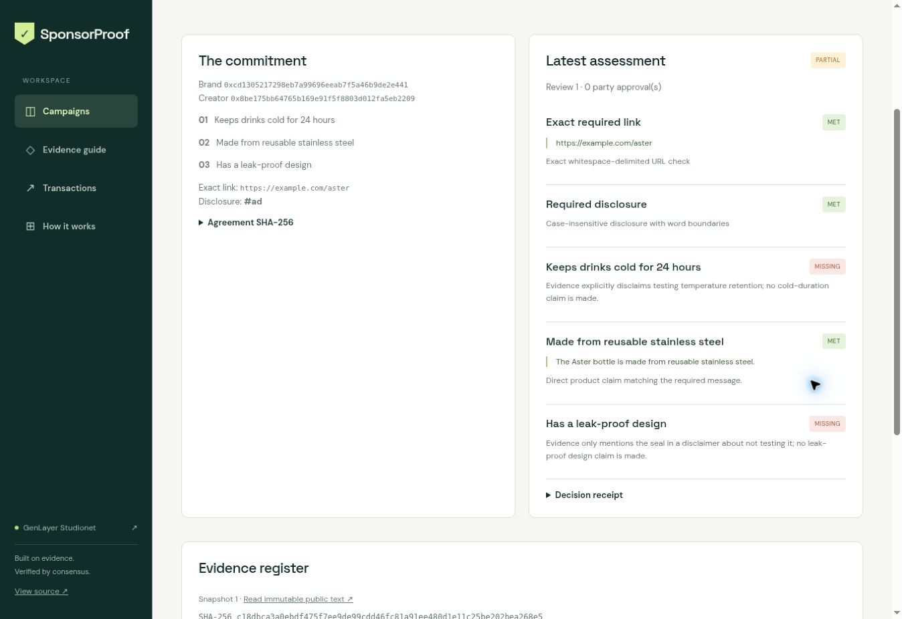
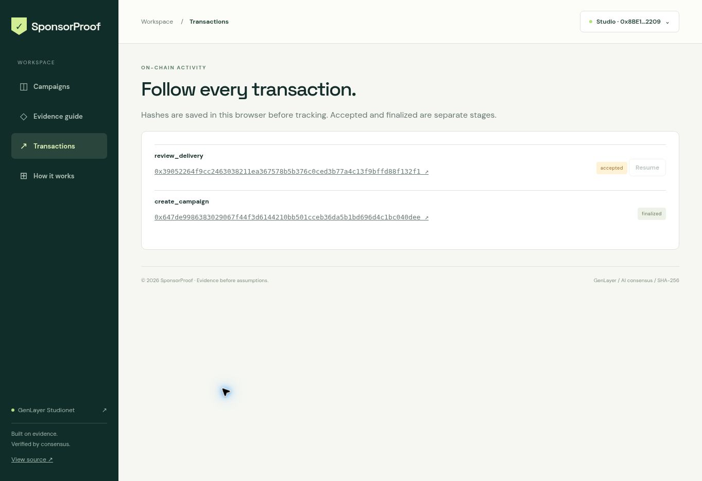

# Verified live evidence

Verified on GenLayer Studionet on 28 October 2026. These are real sandbox transactions, signed with Studio built-in accounts in Normal (Full Consensus) mode. The campaign itself is explicitly synthetic.

Final contract: [`0x57Edf2573acFDba8F9D6e712DF12B96A94633236`](https://explorer-studio.genlayer.com/address/0x57Edf2573acFDba8F9D6e712DF12B96A94633236).

Source SHA-256: `877e4c9293be2975c7f0e8ebd6ae3efb731fb31a3aeca1a7f3a0976e6608fac6`. Deployment code was decoded and compared byte for byte with `contracts/sponsorproof.py`.

| Action | Transaction | Network state | Execution |
| --- | --- | --- | --- |
| deploy | [0x081b8269…](https://explorer-studio.genlayer.com/tx/0x081b826980021321b0cabaed8d2628b5096c52f9577b8a01faeda1f683abe565) | FINALIZED | SUCCESS |
| create_campaign | [0x647de998…](https://explorer-studio.genlayer.com/tx/0x647de9986383029067f44f3d6144210bb501cceb36da5b1bd696d4c1bc040dee) | FINALIZED | SUCCESS |
| submit_delivery | [0x1a1dcd04…](https://explorer-studio.genlayer.com/tx/0x1a1dcd04674330b17dc22769659bc1ef404570e1c6d5dfc3130a0ef8f9cfb18a) | FINALIZED | SUCCESS |
| review_delivery_partial | [0x9504c868…](https://explorer-studio.genlayer.com/tx/0x9504c8684f0bc23f66b2c96d3e0e47776fcc14473152ccf3150b0e46c8147232) | FINALIZED | SUCCESS |
| challenge_review | [0x80241376…](https://explorer-studio.genlayer.com/tx/0x80241376a928abc0abb3e0b5fde30d0f2d2d115fa827e039a4638d86a67fe15a) | FINALIZED | SUCCESS |
| review_delivery_fulfilled | [0x39052264…](https://explorer-studio.genlayer.com/tx/0x39052264f9cc2463038211ea367578b5b376c0ced3b77a4c13f9bffd88f132f1) | FINALIZED | SUCCESS |
| finalize_delivery_creator | [0x3a94d8c5…](https://explorer-studio.genlayer.com/tx/0x3a94d8c57e1a0a105decdd5f34c8dd43596874cf6f7be984d90b0d80afce8d77) | FINALIZED | SUCCESS |
| finalize_delivery_brand | [0x3dc4e255…](https://explorer-studio.genlayer.com/tx/0x3dc4e2550fdc1b682960807ce3612a4aa76f7aa087af734e1a04d44ade14464d) | FINALIZED | SUCCESS |
| create_campaign_duplicate_expected_failure | [0xb777b974…](https://explorer-studio.genlayer.com/tx/0xb777b97441f1ad2bbc7d733e09d4d94ffb9470b1614e69d145421ab33fd15aec) | FINALIZED | ERROR |

The duplicate campaign transaction is an intentional negative test. Its consensus decision finalized with execution ERROR/rollback; this must not be displayed as a successful operation. A subsequent finalized-state read confirmed that the original campaign remained FINALIZED with two reviews, one challenge, and two distinct approvals.

## Recorded result

- First immutable snapshot: PARTIAL. Exact link, disclosure, and reusable steel message MET; cold-retention and leak-proof messages MISSING.
- Creator challenged once with a second commit-pinned, hash-checked snapshot.
- Second review: FULFILLED, all five checks MET.
- Creator and brand separately accepted decision hash `785a025ca726214935d518b92cadab0ed5eac548f1cbd8135691c7596f179f9a`.
- Finalized contract read: FINALIZED; both distinct party addresses are present in approvals. Earlier review and challenge history remain intact.

## Frontend and local validation

The browser linked the create transaction after checking its signer and decoded calldata. It also linked the second real AI review while in flight and visibly tracked accepted → finalized. Offline tests verify pending, failed, transport-error, and timeout/resume behavior, plus rejection of unrelated or leader-only receipts. The interface uses a manual Studio signing handoff, not direct frontend transaction submission.

39 offline tests passed, the actual pinned SDK direct smoke passed, GenVM lint and semantic validation passed, and the production build passed. Real AI classifications are verified above; local web and AI mocks are not presented as network consensus evidence.

## Screenshots

## Verification data

- [verification.json](verification.json): compact receipts, votes, source hash and source comparison.
- [demo-state.json](demo-state.json): finalized campaign record with complete reviews and challenge.
- [transaction-index.json](transaction-index.json): reproducible read-only collection inputs.
- [superseded-transactions.ndjson](superseded-transactions.ndjson): earlier corrected deployment history.

No production network, payment release, original-social-post provenance, security audit, or direct Studio cross-site signer is claimed.
